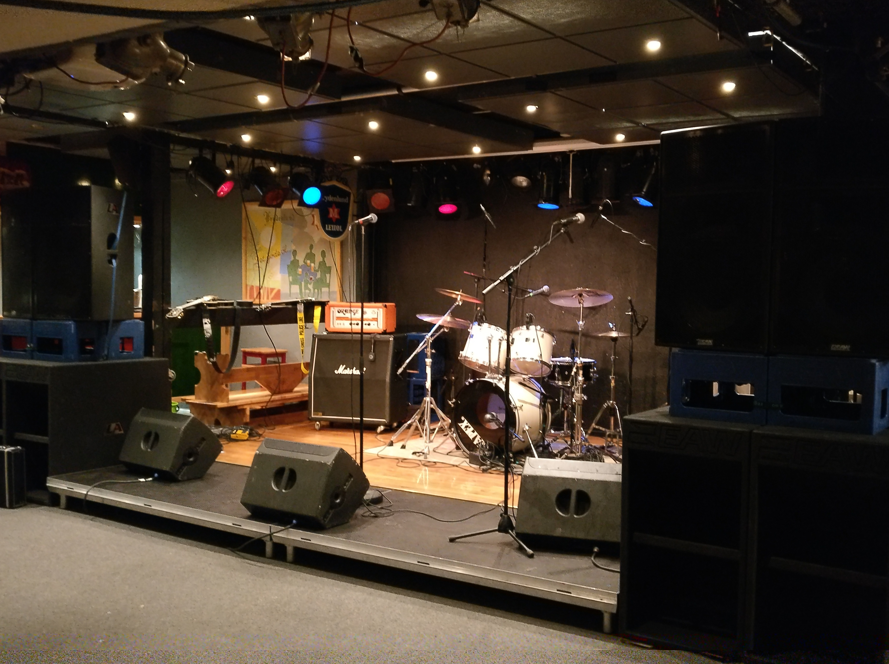
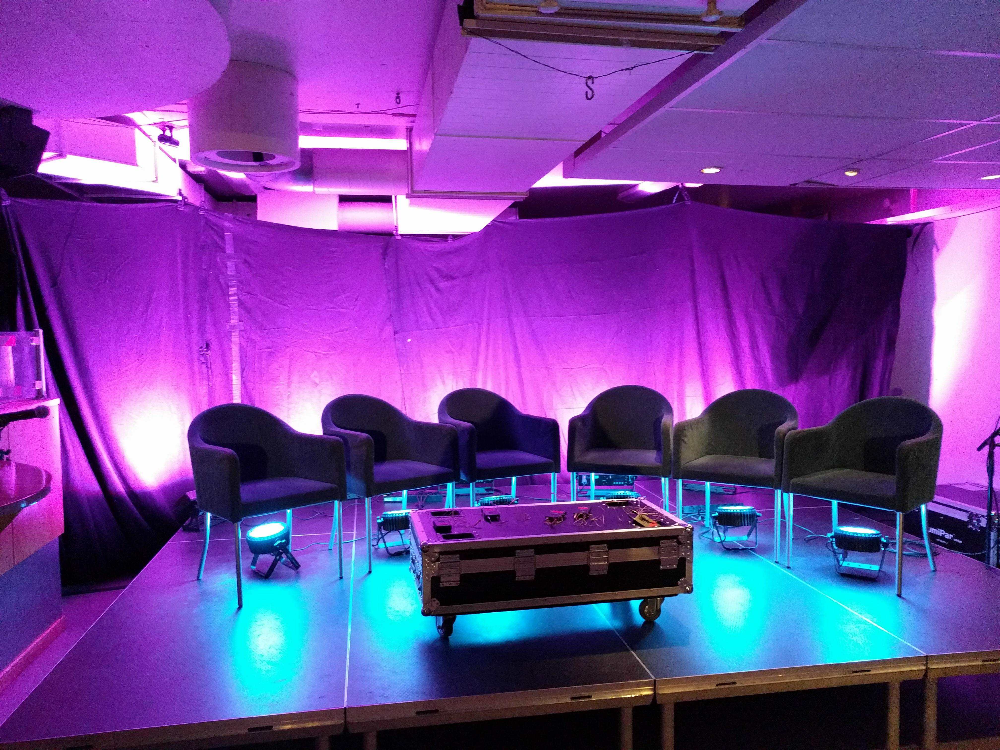
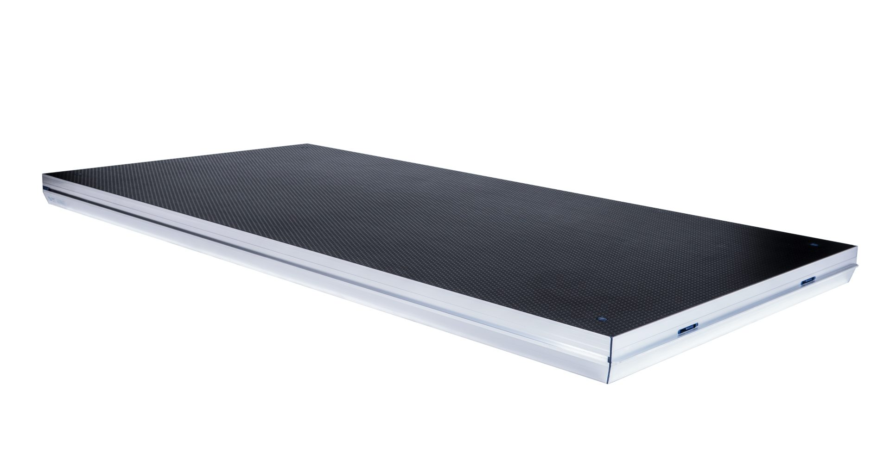
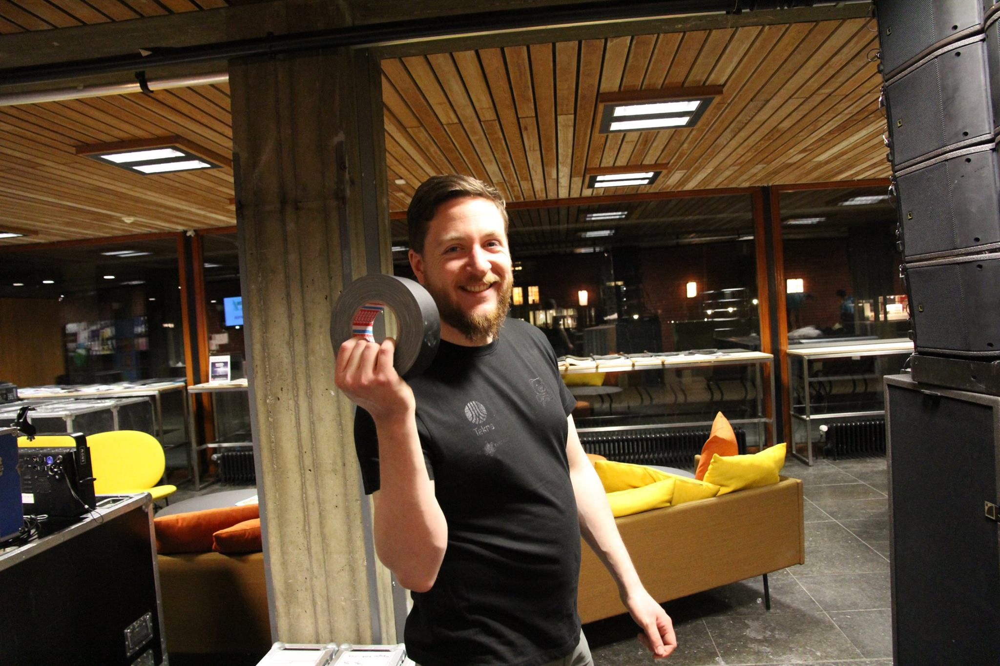

RF-Regi har et bredt spekter av utstyr. Vi har en utstyrspark som burde dekke de fleste behov for studentforeninger på UiO. Har en komplett konsertpakke på lyd siden som burde dekke de fleste ridere og skal være veldig rider vennlig.

På lys siden har vi 4 movinghead og en rekke led og tradisjonelle lamper som skal kunne brukes på konsert. Vi har gått for GrandMA på lyskontroller valget, og har en GrandMa OnPC løsning med touch skjerm og commanderwing.

Når det gjelder bruk av utstyr vil vi anbefale å leie en tekniker hvis dere ikke har erfaring med utstyret eller en rigger hvis det er slik at dere har eksterne teknikere. Er du usikker på om du trenger dette eller ikke så ta en prat med oss. Vi har en rekke teknikere med god erfaring innenfor lyd og lys som har vært teknikere på diverse konserter.

## Mere info

- 
- 
- 
- 
